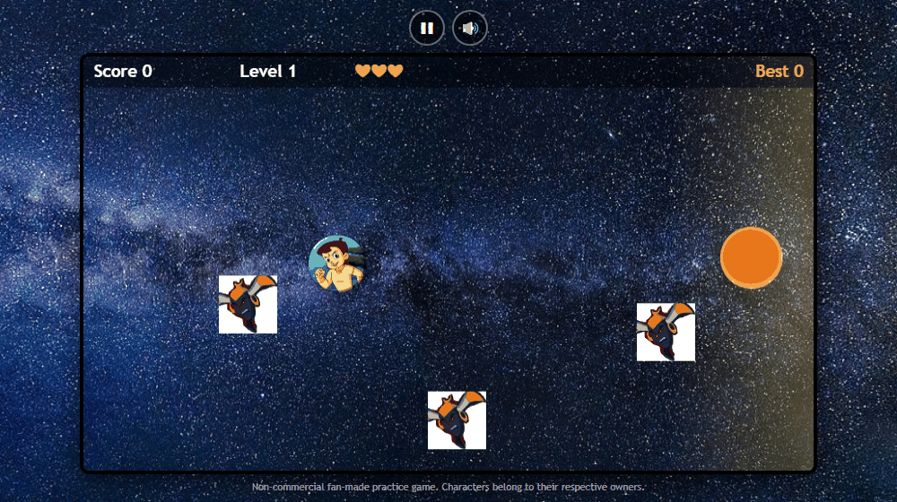
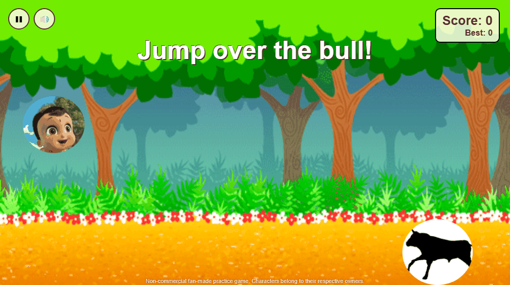

# Adventure Games

A single page that bundles four small browser games. It opens on a welcome page with a card for each game; pick one from the sidebar (a top bar on phones) or a card and it loads next to it. The active game is highlighted, and each game has its own link (`#game1` ... `#game4`) plus an "open full screen" link.

**Live demo:** https://akshaytripathiai.github.io/Adventure-Game/



## Games

| Menu | Game | Controls | Standalone repo |
|------|------|----------|-----------------|
| Game 1 | **Bheem Ladoo Dash**: hold to run, dodge bouncing Kirmadas, reach the ladoo; levels get harder, 3 hearts | Hold `Space` / `Right` / mouse / touch to run, `Left` to step back | [basic-bheem-ladoo-game](https://github.com/AkshayTripathiAI/basic-bheem-ladoo-game) |
| Game 2 | **Chota Bheem Loves Ladoo**: collect ladoos (golden ones give a heart), avoid chasing enemies, level up | Arrow keys / `WASD`, or drag on touch screens | [Bheem-Ladoo-2](https://github.com/AkshayTripathiAI/Bheem-Ladoo-2) |
| Game 3 | **Chota Bheem Adventures**: jump over a charging bull that gets faster with every dodge | `Up` / `Space` / tap to jump, `Left`/`Right` to move, on-screen buttons on touch devices | [Chota-Bheem-Adventure-game](https://github.com/AkshayTripathiAI/Chota-Bheem-Adventure-game) |
| Game 4 | **Gravity Ball**: side-scrolling level where you flip gravity to get past walls; checkpoints and best time | `Left`/`Right` to move, `Space`/`Up` to flip gravity, `R` new game, on-screen buttons on touch devices | - |

All games have a start screen, pause or restart, a mute toggle (`M`), a best score or best time saved in `localStorage`, and no audio before your first click or key press.

Games 1-3 are non-commercial, fan-made practice games based on the Chhota Bheem characters. Characters and names belong to their respective owners; this is a non-commercial fan project. Images and audio are used for learning purposes. Game 4 uses CreateJS and sound effects whose file names credit their Freesound authors.

## Screenshots

| Game 2 | Game 3 | Game 4 |
|:------:|:------:|:------:|
|  |  |  |

## Tech stack

- HTML, CSS (responsive Flexbox/Grid launcher), vanilla JavaScript, no build step
- HTML5 Canvas (Games 1, 2), DOM sprites driven by `requestAnimationFrame` (Game 3)
- [CreateJS / PreloadJS](https://createjs.com/) loaded from CDN (Game 4)

## Run locally

```bash
git clone https://github.com/AkshayTripathiAI/Adventure-Game.git
cd Adventure-Game
npx serve docs
```

Then open the printed URL and pick a game. Opening `docs/index.html` directly also works for most games, but a local server is more reliable for iframes and audio.

## Project structure

```
docs/                # everything GitHub Pages serves
  index.html         # welcome page + game launcher
  Game1/             # Bheem Ladoo Dash (canvas)
  Game2/             # Chota Bheem Loves Ladoo (canvas)
  Game3/             # Chota Bheem Adventures (DOM sprites)
  Game4/             # Gravity Ball (CreateJS); images and sounds in Game4/assets/
  screenshots/       # images used here and on the welcome page
```
