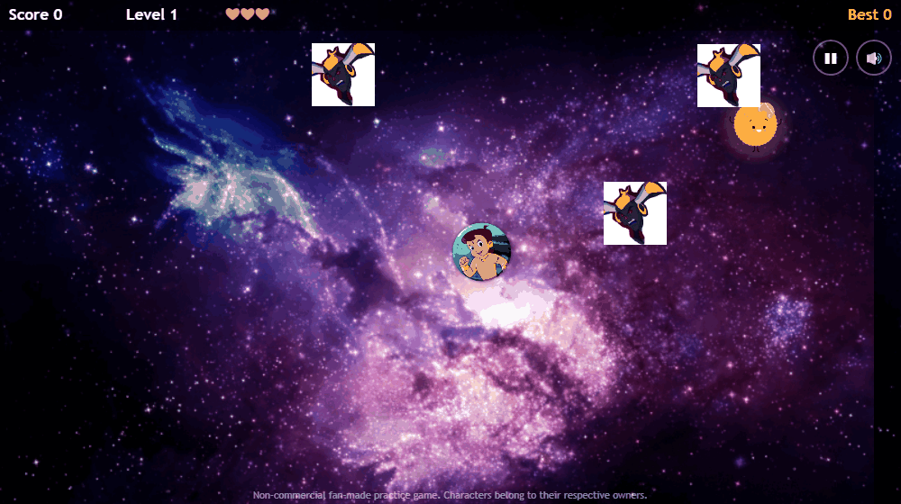
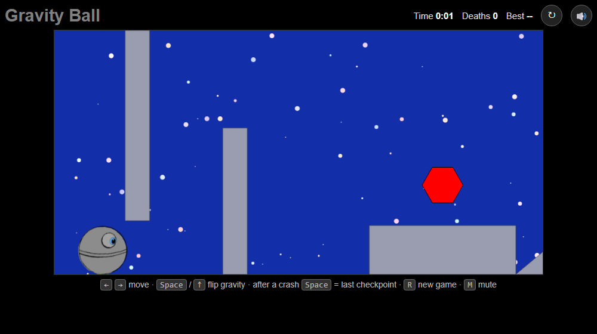

# Adventure Games

A single page that bundles four small browser games. Pick a game from the sidebar and it loads in an iframe next to it.

**Live demo:** https://akshaytripathiai.github.io/Adventure-Game/


## Games

| Button | Game | Controls | Standalone repo |
|--------|------|----------|-----------------|
| Game 1 | Basic Bheem Ladoo: reach the ladoo while dodging bouncing enemies | Hold mouse button to move | [basic-bheem-ladoo-game](https://github.com/AkshayTripathiAI/basic-bheem-ladoo-game) |
| Game 2 | Chota Bheem Loves Ladoo: collect ladoos, avoid chasing enemies, level up | Arrow keys / touch | [Bheem-Ladoo-2](https://github.com/AkshayTripathiAI/Bheem-Ladoo-2) |
| Game 3 | Chota Bheem Adventures: jump over a charging bull | Up arrow to jump, Left/Right to move | [Chota-Bheem-Adventure-game](https://github.com/AkshayTripathiAI/Chota-Bheem-Adventure-game) |
| Game 4 | Gravity Ball: side-scrolling level where you flip gravity to get past walls | Left/Right arrows, Space to flip gravity | - |

Games 1-3 are non-commercial, fan-made practice games based on the Chhota Bheem characters. Characters and names belong to their respective owners; this is a non-commercial fan project. Images and audio are used for learning purposes. Game 4 uses CreateJS and sound effects whose file names credit their Freesound authors.

## Screenshots

| Game 2 | Game 3 | Game 4 |
|:------:|:------:|:------:|
|  |  |  |

## Tech stack

- HTML, CSS (Flexbox sidebar layout), vanilla JavaScript
- HTML5 Canvas (Games 1, 2), CSS animations (Game 3)
- [CreateJS / PreloadJS](https://createjs.com/) loaded from CDN (Game 4)

## Run locally

```bash
git clone https://github.com/AkshayTripathiAI/Adventure-Game.git
cd Adventure-Game
npx serve .
```

Then open the printed URL and pick a game from the sidebar. Opening `index.html` directly also works for most games, but a local server is more reliable for iframes and audio.

## Project structure

```
index.html     # sidebar + iframe launcher
Game1/         # Basic Bheem Ladoo (canvas)
Game2/         # Chota Bheem Loves Ladoo (canvas)
Game3/         # Chota Bheem Adventures (DOM + CSS animations)
Game4/         # Gravity Ball (CreateJS)
screenshots/   # images used in this README
```
